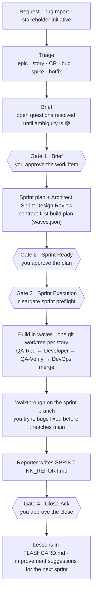

# ClearGate

**The gated software factory for AI coding agents.**
*Agents build. Humans hold the gates.*

ClearGate installs into your repo and turns Claude Code into a software factory with a real production line. Requests come in and get triaged. They are specified until nothing is ambiguous, then planned into a sprint. Parallel agents build them in isolated git worktrees, and the result is verified, merged and reported on. You sign off at the gates that matter: before a work item is approved, before a sprint starts, and before it closes. Every step leaves a record in your repo.

```bash
npx cleargate init      # install the factory into this repo
npx cleargate doctor    # check it's healthy
```

---

## Why "gated"

A *dark* software factory ships code that no human reads. ClearGate sits at the other end: a *light* factory. Agents write the drafts, the tests, the code, the review passes and the merges. They don't get to decide what to build, start a sprint whose plan isn't ready, or close a sprint without you.

The gates aren't just prompts. Where it counts, hooks and scripts enforce them:

- **Red tests are locked.** QA writes failing tests before any code exists. A pre-commit hook rejects any Developer commit that edits them.
- **Each story has a declared file surface.** A pre-commit hook rejects commits that touch files outside it.
- **Readiness is checked, not assumed.** `cleargate gate check` stamps every work item, and `cleargate sprint preflight` hard-blocks a sprint if any item fails.
- **Close needs you.** The close script halts for your explicit acknowledgement and refuses the bypass flag outside CI.
- **Lessons are processed, not dropped.** The next agent dispatch is blocked until every flagged lesson is approved or rejected.

ClearGate's own overrides are explicit, named environment variables, so overriding a gate is always a visible decision.

---

## The line



### The four gates

| Gate | When | What must be true | How it holds |
|---|---|---|---|
| **1 · Brief** | Each work item | The agent presents a Brief (summary, open questions, edge cases, risks). Every question is resolved and ambiguity is 🟢. | The agent halts for your approval. The MCP server rejects any push without `approved: true`. |
| **2 · Sprint Ready** | Each sprint | Every item is decomposed and 🟢, the sprint Brief is resolved, and the Architect's Sprint Design Review is written. | The agent halts for your approval. |
| **3 · Sprint Execution** | Before the first story | `cleargate sprint preflight` passes five checks: previous sprint closed, no leftover worktrees, sprint branch free, `main` clean, every item's readiness gate green. | The CLI exits non-zero, so the sprint doesn't start. |
| **4 · Close-Ack** | End of sprint | Reconcilers pass: commits match ticket state, no orphaned items, no leftover worktrees, sprint branch merged to `main`. | `close_sprint.mjs` halts for your explicit go. |

### The stations

| Agent | What it does | What it never does |
|---|---|---|
| **Architect** | Runs the Sprint Design Review. One reader per story maps its file surface and its contracts with other stories, and a synthesizer turns that into a build-then-integrate plan (`waves.json`). Writes each milestone plan. Also checks test wiring and reviews merges after QA, when a scan flags a risk. | Write production code. |
| **QA** | **Red:** turns each story's Gherkin scenarios into failing tests before any code exists. **Verify:** read-only check that every scenario maps to a passing test and the Definition of Done is met. | Edit code. It approves or kicks back. |
| **Developer** | Implements one story in its own git worktree, inside the story's declared file surface, and commits once. | Touch the red tests or files outside its surface. |
| **DevOps** | Merges with `--no-ff` into the sprint branch, tears down the worktree and moves the story to Done. | Author code. It halts on a merge conflict. |
| **Reporter** | Runs once per sprint. Writes the sprint report from the token ledger, git log, lessons and DoD. | Change any other file. |

**Lanes.** Standard-lane stories run the full line. Small, low-risk stories run on the **fast lane**, which skips QA-Red and the Architect passes. A story qualifies only by passing a seven-check rubric. Examples: at most 2 files and 50 lines, a single scenario, no new dependency, and existing tests already cover it. A fast-lane story that turns out harder is demoted back to standard. Urgent off-sprint fixes use `cleargate hotfix new` (≤ 2 files, ≤ 30 lines, with verification and rollback steps).

**Parallelism.** In Claude Code, each wave of stories runs in parallel. Hosts without a parallel workflow primitive run the same plan one story at a time.

---

## What the factory leaves behind

Everything is plain files in your repo, versioned with your code:

- **Work items:** epics, stories, CRs, bugs, spikes, hotfixes and sprint plans as markdown in `.cleargate/delivery/`.
- **Sprint runs:** `.cleargate/sprint-runs/<sprint>/` holds the Architect plans, `waves.json`, story state, an event log, a per-agent token ledger (written by a hook) and the sprint report.
- **Sprint report:** first-pass success rate, QA and Architect bounce counts, Bug-Fix Tax, fast-lane demotion rate, a hotfix audit and token spend per agent. `suggest_improvements.mjs` turns its self-assessment into tracked improvement suggestions for the next sprint.
- **`FLASHCARD.md`:** an append-only log of one-line lessons, tagged by topic. Agents read it before non-trivial work.
- **Awareness wiki:** `cleargate wiki build` compiles your work items into a compact `.cleargate/wiki/index.md` that the agent reads at session start, so it knows what exists before it greps anything. A hook keeps the wiki current as work items change.
- **Dashboard:** `cleargate sprint dashboard` renders a visual view of story states, waves, worktrees and token spend.

---

## What ClearGate is not

- **Not a deploy pipeline.** The line ends at verified code merged to your `main`. Shipping to production is your CI/CD's job.
- **Not lights-out.** The factory runs inside an agent session that you start. Within a sprint it works through the waves on its own, but it doesn't pick up new work by itself, and it stops at every gate.
- **Not a toolchain.** Agents run *your* tests, typecheck and lint through the commands you configure.
- **Not a hosted service.** It runs entirely from files in your repo, with no account or server needed. The [MCP server](#optional-the-cleargate-mcp-server) is optional.

---

## Install

Requires Node ≥ 24 and `git`.

```bash
npx cleargate init
npx cleargate doctor
```

`init` writes a bounded `<!-- CLEARGATE:START -->…<!-- CLEARGATE:END -->` block into `CLAUDE.md` (your prose outside it is kept). It installs the agents, skills and hooks under `.claude/`, scaffolds `.cleargate/`, and adds `.worktrees/` to your `.gitignore`. Re-running it is idempotent. `doctor` reports scaffold drift, hook health and work items that are blocked on a readiness gate.

To pin a version for every contributor, run `npm i -D cleargate`.

### Give it to your agent

Already in Claude Code? Paste this:

```text
Install ClearGate (npm package: cleargate) in this project.

1. Run `npx cleargate init` from the repo root. Report what files it
   created or modified.
2. Run `npx cleargate doctor`. Surface any warnings or errors verbatim.
3. Read the bounded `<!-- CLEARGATE:START -->...<!-- CLEARGATE:END -->`
   block now in CLAUDE.md. In 3 lines, summarize how this changes how
   we'll plan and execute work from now on.
4. List `.claude/agents/` and `.cleargate/templates/` — one line per
   item — so I can see what's available.

Do not write any production code yet. This is install + verification
only. If any step errors, stop and report the exact error.
```

### Hosts

| Host | Status | Install |
|---|---|---|
| **Claude Code** | Primary. Every ClearGate sprint to date has run here. | `npx cleargate init` (default) |
| **OpenAI Codex** | **Preview.** It installs, but no full live sprint has been run on Codex yet, and known issues are open. Waves run one story at a time. | `npx cleargate init --host codex` (or `--host all`) |

---

## Your first sprint

1. **Ask for something.** *"I want to add [feature]."* The agent classifies it (epic, story, CR, bug or spike), drafts it under `.cleargate/delivery/pending-sync/` and presents a Brief. Answer its open questions until ambiguity is 🟢, then approve. **That's Gate 1.**
2. **Decompose.** Epics split into stories. Each story gets Gherkin acceptance scenarios and a declared file surface.
3. **Plan the sprint.** Ask the agent to plan a sprint. It drafts the sprint plan, and the Architect runs the Sprint Design Review. Review the plan and approve it. **That's Gate 2.**
4. **Start it.** Ask the agent to start the sprint. `cleargate sprint preflight` checks the environment (**Gate 3**). Then the agents work through the waves: QA-Red → Developer → QA-Verify → DevOps for each story.
5. **Walk through it.** Try the result on the sprint branch. Anything you report is triaged, and bugs are fixed before the branch reaches `main`.
6. **Close it.** The Reporter writes `SPRINT-NN_REPORT.md`. `cleargate sprint close <id>` halts for your explicit acknowledgement. **That's Gate 4.**

### Configure your toolchain

Agents call your project's own commands through `cleargate gate <name>`. Copy `.cleargate/config.example.yml` to `.cleargate/config.yml`, then set:

```yaml
gates:
  precommit: "npm run typecheck && npm test"
  test: "npm test"
  typecheck: "npm run typecheck"
  lint: "npm run lint"
```

A gate you haven't configured prints a "not configured" message and exits 0. Pass `--strict` to make it exit 1.

---

## What `init` lays down

```text
your-repo/
├── CLAUDE.md                ← bounded ClearGate block
├── .claude/
│   ├── agents/              ← architect · architect-reader · architect-synth · developer
│   │                           · qa · devops · reporter · 4 wiki agents
│   ├── skills/              ← sprint-execution · flashcard · sprint-dashboard
│   ├── hooks/               ← session-start · token-ledger · pre-commit surface & red-test
│   │                           gates · pre-edit gate · lesson sentinel · …
│   └── settings.json        ← hook wiring
└── .cleargate/
    ├── FLASHCARD.md         ← lesson log
    ├── config.example.yml   ← your gate commands (copy to config.yml)
    ├── knowledge/           ← protocol · enforcement rules · readiness gates
    │                           · mid-sprint triage rubric · close-out checklist
    ├── templates/           ← epic · story · CR · bug · spike · hotfix · initiative
    │                           · sprint plan · sprint context · sprint report
    ├── scripts/             ← close_sprint.mjs · launch_wave.mjs · suggest_improvements.mjs · …
    └── delivery/
        ├── pending-sync/    ← drafts and in-flight work items
        └── archive/         ← approved and completed work items
```

`.cleargate/.gitignore` keeps per-machine state out of your commits: your identity file, sync markers, hook logs and dashboard snapshots.

---

## Commands

```bash
cleargate init [--host claude|codex|all]      # install the factory
cleargate doctor                              # scaffold health: drift, hooks, blocked items
cleargate new <type> "<slug>"                 # epic · story (--epic EPIC-NNN) · cr · bug · spike
                                              #   · hotfix · initiative · sprint
cleargate gate check <file>                   # evaluate and stamp a work item's readiness
cleargate gate explain <file>                 # why a work item is or isn't ready
cleargate gate test|typecheck|lint|precommit  # run your configured command
cleargate sprint init|preflight|close <id>    # sprint lifecycle (preflight = Gate 3, close = Gate 4)
cleargate sprint dashboard                    # visual sprint progress
cleargate story start|complete <id>           # story worktree and state transitions
cleargate hotfix new <slug>                   # off-sprint hotfix
cleargate wiki build|query|lint               # awareness wiki
cleargate host list|add|remove                # manage installed hosts
cleargate upgrade [--dry-run]                 # three-way merge of scaffold updates
cleargate uninstall                           # remove the scaffold, keep your work items
```

To upgrade, run `npx cleargate@latest upgrade`. That uses the new binary, not an older global install. Your work items, `FLASHCARD.md`, `config.yml` and any prose outside the `CLAUDE.md` block are never touched. Full CLI reference: the [`cleargate` package on npm](https://www.npmjs.com/package/cleargate).

---

## Optional: the ClearGate MCP server

Everything above runs locally. The MCP server is an optional, **invite-only** service for teams that want a shared record outside the repo:

- Members join with `cleargate join <invite-url>`, then `cleargate push` approved work items and sprint reports into its versioned store. It keeps the last 10 versions of each item and rejects any push without `approved: true`.
- An admin console shows projects, members, tokens, items and audit history.
- A read-only **Linear** adapter can pull issues, comments and updates in.

What it does **not** do today: push never writes out to Linear, Jira or GitHub, and only the Linear adapter exists. Writing out to PM tools is on the roadmap. The server isn't open for self-hosting yet. Without a join token, `push`, `pull` and `sync` exit with a pointer to `cleargate join`, and everything else works.

---

## Built with itself

ClearGate is built with ClearGate. This repo is its own factory floor: 36 sprints of work items, Architect plans, token ledgers and sprint reports live under [`.cleargate/`](./.cleargate/). Read any report, e.g. [`SPRINT-41_REPORT.md`](./.cleargate/sprint-runs/SPRINT-41/SPRINT-41_REPORT.md), to see what the line produces, including the parts that didn't go to plan.

How the pieces fit together (CLI, scaffold, MCP server, admin console): [docs/INTERNALS.md](./docs/INTERNALS.md).

## License

MIT. See [LICENSE](./LICENSE).
